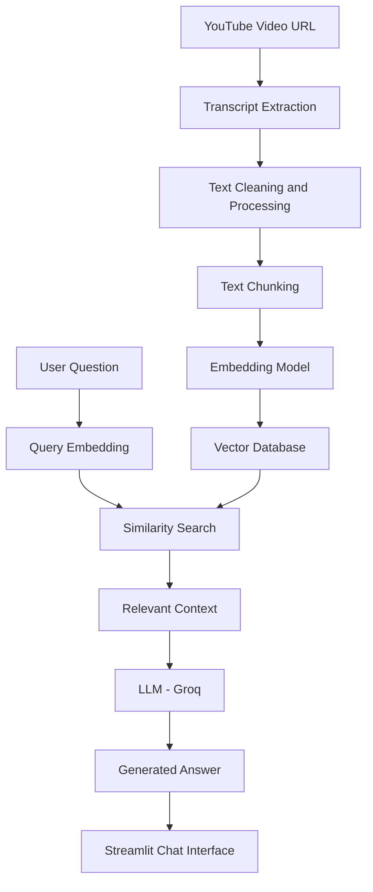

# 🎥 YouTube Video Chatbot – Chat with Any YouTube Video

An AI-powered YouTube Video Chatbot that allows users to interact with YouTube videos through natural language conversations. Simply provide a YouTube video URL, and the application extracts its transcript, processes the content, creates a searchable vector database, and uses Retrieval-Augmented Generation (RAG) to answer questions based on the video.

Instead of watching an entire video to find specific information, you can directly ask questions and get contextual answers from its content.

## 🚀 Features

- **YouTube Transcript Extraction:** Extracts transcripts directly from YouTube videos using a provided video URL.
- **Automatic Text Processing:** Splits the extracted transcript into smaller, meaningful chunks for efficient retrieval.
- **Vector Database Creation:** Generates embeddings from transcript chunks and stores them in a vector database.
- **Semantic Search:** Retrieves relevant information based on the meaning of the user's query rather than relying only on keyword matching.
- **AI-Powered Chatbot:** Uses an LLM to generate contextual answers using retrieved video content.
- **Context-Aware Conversations:** Ask multiple questions about the same video without manually searching through the transcript.
- **Interactive UI:** Provides a simple and user-friendly interface built with Streamlit.

## 🏗️ Architecture

The application follows a Retrieval-Augmented Generation (RAG) architecture.



## ⚙️ How It Works

The application works in two major stages:

### 1. Video Processing and Database Creation

1. The user provides a YouTube video URL.
2. The application extracts the video's transcript.
3. The transcript is cleaned and divided into smaller chunks.
4. An embedding model converts each chunk into a numerical vector representation.
5. These vectors, along with their associated text and metadata, are stored in a vector database.

### 2. Question Answering Using RAG

1. The user asks a question about the video.
2. The question is converted into an embedding.
3. The vector database performs semantic similarity search.
4. The most relevant transcript chunks are retrieved.
5. The retrieved context is passed to the LLM.
6. The LLM generates an answer grounded in the retrieved video content.
7. The answer is displayed in the Streamlit interface.

## 🛠️ Tech Stack

| Technology | Purpose |
|---|---|
| Python | Core programming language |
| Streamlit | Interactive frontend |
| LangChain | RAG pipeline and LLM integration |
| Groq API | Fast LLM inference |
| Hugging Face | Text embedding models |
| Vector Database | Storage and retrieval of transcript embeddings |
| YouTube Transcript API | YouTube transcript extraction |
| uv | Python package and environment management |

## 📂 Project Structure

```text
youtube-video-chatbot/
│
├── app.py                  # Streamlit application
├── requirements.txt        # Project dependencies
├── pyproject.toml          # Project configuration
├── .env                    # Environment variables
├── .gitignore
│
├── src/
│   ├── transcript.py       # YouTube transcript extraction
│   ├── preprocessing.py    # Transcript cleaning and chunking
│   ├── embeddings.py       # Embedding generation
│   ├── vectorstore.py      # Vector database creation and retrieval
│   └── chatbot.py          # RAG-based question answering
│
├── storage/
│   └── vector_db/          # Persisted vector database
│
└── README.md
```

*Note: Adjust the structure according to your actual implementation.*

## 🔧 Installation and Setup

### Prerequisites

- Python 3.10+
- [uv](https://docs.astral.sh/uv/)
- Groq API key

### 1. Clone the Repository

```bash
git clone https://github.com/your-username/youtube-video-chatbot.git
```

```bash
cd youtube-video-chatbot
```

### 2. Create a Virtual Environment

```bash
uv venv
```

Activate the environment:

**Windows:**
```bash
.venv\Scripts\activate
```

**Linux / macOS:**
```bash
source .venv/bin/activate
```

### 3. Install Dependencies

```bash
uv sync
```

If you are using `requirements.txt` instead:

```bash
uv pip install -r requirements.txt
```

### 4. Configure Environment Variables

Create a `.env` file in the root directory:

```env
GROQ_API_KEY=your_groq_api_key
```

Replace the placeholder with your actual Groq API key.

### 5. Run the Application

```bash
uv run streamlit run app.py
```

Open the local URL displayed in your terminal to access the application.

## 💬 Example Usage

1. Launch the application.
2. Paste a YouTube video URL.
3. Start the video processing pipeline.
4. Wait for transcript extraction and vector database creation.
5. Once processing is complete, start asking questions.

**Example questions:**

- What is the main topic discussed in this video?
- Explain the concept discussed in the second half.
- What are the key takeaways from this video?
- Summarize the important points.
- Can you explain a particular concept with an example?

## 🔑 Environment Variables

| Variable | Description |
|---|---|
| `GROQ_API_KEY` | API key used for LLM inference |

## 🧠 Core Concepts Used

This project demonstrates practical implementation of several important AI and NLP concepts:

- Retrieval-Augmented Generation (RAG)
- Large Language Models (LLMs)
- Text Embeddings
- Semantic Similarity Search
- Vector Databases
- Text Chunking and Preprocessing
- Prompt Engineering
- Context-Aware Question Answering

## 🔮 Future Improvements

- [ ] Support multiple YouTube videos in a single knowledge base.
- [ ] Add chat history and conversational memory.
- [ ] Display source transcript chunks with timestamps.
- [ ] Support multilingual video transcripts.
- [ ] Add automatic video summarization.
- [ ] Implement hybrid retrieval using BM25 and vector search.
- [ ] Add retrieval evaluation using Recall@K and other RAG metrics.
- [ ] Optimize database persistence and caching.
- [ ] Deploy the application to a cloud platform.

## ⚠️ Limitations

- Videos must have accessible transcripts or captions.
- Transcript extraction may fail for videos with disabled or unavailable captions.
- Answer quality depends on transcript quality, retrieval accuracy, and the selected LLM.
- The application answers based on the available transcript and may not understand visual information that is not described in the transcript.

## 🤝 Contributing

Contributions, issues, and feature requests are welcome!

1. Fork the repository.
2. Create a new feature branch.
3. Commit your changes.
4. Push your branch.
5. Open a Pull Request.

## 📜 License

This project is open-source and available under the MIT License.

---

**Built with Python, LangChain, Groq, and Streamlit.**
